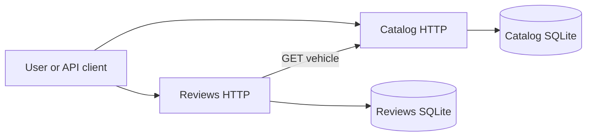
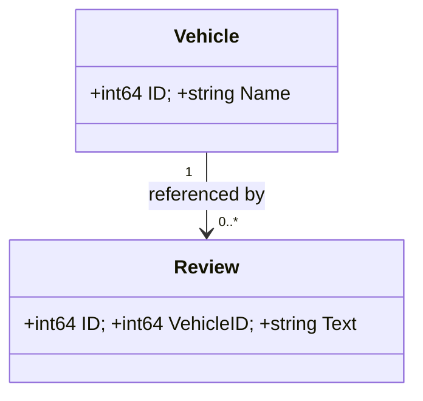

# Architecture and decisions

The client can list or add vehicles in Catalog and add or list reviews in Reviews. There are no user roles or login.

## Evidence mapping

| Topic | Implementation | Limitation |
|---|---|---|
| Go, HTTP, routing | `cmd/`, `internal/catalog/`, `internal/reviews/` | Limited CRUD operations |
| Middleware | `internal/shared/http.go` | No distributed tracing |
| Repository and storage | `Repository` interfaces and `SQLiteRepo` in each service | Local SQLite, no migration tool |
| MVC concepts | Catalog handlers, `Vehicle`, `vehicleView` and HTML template | Minimal HTML view |
| Dependency inversion | Service dependencies on `Repository` and `VehicleChecker` interfaces | A teaching illustration, not a full Clean Architecture implementation |
| Service communication | `HTTPVehicleChecker.Exists` | Synchronous HTTP; no distributed transaction |
| Tests | `internal/integration/`, `internal/catalog/catalog_test.go` and saved results | No load or full browser end-to-end test |

## Decisions and risks

Separate services and databases demonstrate boundaries but introduce network failure and consistency risks. SQLite keeps setup simple but does not provide horizontal scaling. The HTTP client has a three-second timeout and returns 502 when Catalog is unavailable. Authentication, authorization, retries, monitoring, and production deployment are outside the demo scope.
